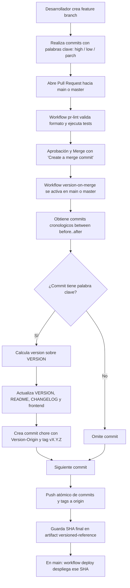

# Versionamiento Automático por Commits

Versión: **1.0.0**

Sistema de versionado semántico automatizado mediante **GitHub Actions**. Permite que cada desarrollador declare el impacto de sus cambios en sus mensajes de commit; al fusionarse a la rama principal (`main`), el bot calcula la versión incremental, actualiza el archivo `VERSION`, sincroniza el frontend y README, actualiza `CHANGELOG.md`, genera los commits correspondientes con trailers `Version-Origin` y publica los tags de Git en el orden cronológico exacto en una operación atómica.

---

## 📋 Convención y Formato de Commits

Para que un commit dispare un incremento de versión, debe seguir la siguiente estructura:

```text
tipo(modulo): <palabra_clave> [incremento] descripcion del cambio
```

### Componentes:
- **`tipo`**: Clase de cambio bajo Conventional Commits (`feat`, `fix`, `refactor`, `perf`, `docs`, `chore`, etc.).
- **`(modulo)`**: *(Opcional)* Alcance o módulo del sistema afectado (ej. `(auth)`, `(billing)`, `(M01)`).
- **`<palabra_clave>`**: Determina qué segmento de la versión se incrementará (`high`, `low`, `parch`, `patch`).
- **`[incremento]`**: Segmento numérico fijo asociado a la palabra clave (`[1.0.0]`, `[0.1.0]`, `[0.0.1]`). **Nota:** No es la versión final del proyecto; el bot calcula la versión real a partir del archivo `VERSION`.
- **`descripcion`**: Explicación breve y clara del cambio realizado (obligatoria).

---

## 🏷️ Palabras Clave y Efecto en la Versión

| Impacto | Declaración correcta | Efecto en SemVer (`MAJOR.MINOR.PATCH`) | Ejemplo de Commit |
|---|---|---|---|
| Cambio mayor / Breaking change | `high [1.0.0]` | Incrementa **MAJOR** y reinicia `MINOR` y `PATCH` a `0`. | `feat(auth): high [1.0.0] refactorizar flujo oauth con breaking change` |
| Funcionalidad / Feature / Mejora | `low [0.1.0]` | Incrementa **MINOR** y reinicia `PATCH` a `0`. | `feat(api): low [0.1.0] agregar endpoint de busqueda avanzada` |
| Corrección de bug / Hotfix / Parche | `parch [0.0.1]` / `patch [0.0.1]` | Incrementa **PATCH** manteniendo `MAJOR` y `MINOR`. | `fix(ui): parch [0.0.1] solucionar desbordamiento en modal` |

---

## ⚠️ Regla Crítica: Estrategia de Fusión de Pull Requests

El sistema versiona **commit por commit** preservando la trazabilidad de cada cambio dentro de la rama. Por lo tanto:

- ✅ **Create a merge commit (`--no-ff`)**: **RECOMENDADO.** Conserva todos los commits individuales de la rama más el commit de merge.
- ✅ **Rebase and merge**: **COMPATIBLE.** Reescribe los commits individuales en la base de `main`.
- ❌ **Squash and merge**: **ESTRICTAMENTE PROHIBIDO.** Colapsa todos los commits en un único commit, impidiendo que el bot procese los tags individuales y desincronizando el historial.

---

## ⚙️ ¿Cómo Funciona la Automatización?



---

## 🧪 Comprobaciones Locales

Desde la raíz del proyecto con Python 3 y Git disponibles:

```bash
# 1. Verificar sincronización de VERSION, README y frontend
python3 scripts/versionamiento.py check

# 2. Ejecutar suite completa de pruebas unitarias e integración
python3 -m unittest discover -s tests -p 'test_versionamiento.py'

# 3. Validar commits de tu rama respecto a main antes de abrir PR
git fetch origin main
python3 scripts/versionamiento.py lint \
  --before "$(git rev-parse origin/main)" \
  --after "$(git rev-parse HEAD)"
```

---

## 📁 Archivos Clave del Repositorio

| Archivo | Función |
| --- | --- |
| [`VERSION`](file:///home/patrickortiz/PycharmProjects/Versionamiento/VERSION) | Almacena la versión semántica actual del proyecto (punto de partida del cálculo). |
| [`scripts/versionamiento.py`](file:///home/patrickortiz/PycharmProjects/Versionamiento/scripts/versionamiento.py) | Script central de cálculo, validación (check/lint) y versionado atómico (bump). |
| [`.github/workflows/pr-lint.yml`](file:///home/patrickortiz/PycharmProjects/Versionamiento/.github/workflows/pr-lint.yml) | Workflow de verificación de PR: ejecuta tests, sincronización y validación de sintaxis. |
| [`.github/workflows/version-on-merge.yml`](file:///home/patrickortiz/PycharmProjects/Versionamiento/.github/workflows/version-on-merge.yml) | Workflow principal que versiona en merge a `main` o `master` y emite el artifact. |
| [`.github/workflows/deploy.yml`](file:///home/patrickortiz/PycharmProjects/Versionamiento/.github/workflows/deploy.yml) | Workflow de despliegue encadenado por `workflow_run` que consume el SHA versionado. |
| [`CHANGELOG.md`](file:///home/patrickortiz/PycharmProjects/Versionamiento/CHANGELOG.md) | Historial detallado con trazabilidad de autores, actores y SHAs originales. |
| [`frontend_project/package.json`](file:///home/patrickortiz/PycharmProjects/Versionamiento/frontend_project/package.json) | Manifiesto frontend que recibe la versión sincronizada. |
| [`frontend_project/package-lock.json`](file:///home/patrickortiz/PycharmProjects/Versionamiento/frontend_project/package-lock.json) | Lockfile frontend sincronizado a nivel superior y paquete raíz. |
| [`tests/test_versionamiento.py`](file:///home/patrickortiz/PycharmProjects/Versionamiento/tests/test_versionamiento.py) | Suite de pruebas unitarias e integración con repositorios Git aislados. |
| [`documentacion-versionado.md`](file:///home/patrickortiz/PycharmProjects/Versionamiento/documentacion-versionado.md) | Especificación y diseño técnico detallado de la arquitectura de versionado. |
| [`implementacion/v2.md`](file:///home/patrickortiz/PycharmProjects/Versionamiento/implementacion/v2.md) | Instructivo técnico v2 de la automatización. |
