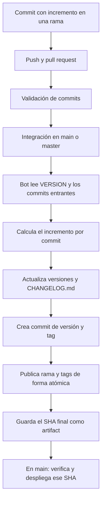

# Instructivo del versionamiento automático de Amazonia Viva

Fecha de revisión: 13 de octubre de 2026.

Este documento explica el uso y funcionamiento del sistema de versiones integrado en Amazonia Viva a partir de [Patrick750/versionamiento](https://github.com/Patrick750/versionamiento). La adaptación inicial tomó como referencia el commit `803bf9e4988540b48b56be1ebaf97f7ef19b0a80`; las explicaciones siguientes corresponden al código actual de este proyecto.

## 1. Qué hace la implementación

El desarrollador declara el impacto de su cambio en el mensaje del commit. Cuando esos commits llegan a `main` o `master`, GitHub Actions calcula las versiones y el bot:

1. Actualiza el archivo `VERSION`.
2. Sincroniza las versiones del frontend y del README.
3. Escribe una entrada en `CHANGELOG.md` por cada commit que declare un incremento.
4. Crea un commit de versión y un tag anotado por cada incremento.
5. Publica los commits y los tags generados en una sola operación atómica.
6. Entrega el SHA final al workflow de despliegue de `main`.

No necesitas editar manualmente la versión final de esos archivos al hacer una corrección. Sí puedes escribir detalles funcionales adicionales en el changelog; el bot conserva el contenido anterior.

## 2. Archivos que intervienen

Todas las rutas de esta tabla son relativas a la raíz del proyecto.

| Archivo | Función |
| --- | --- |
| `VERSION` | Guarda la versión actual y sirve como punto de partida del cálculo. |
| `scripts/versionamiento.py` | Valida los mensajes, calcula incrementos, escribe archivos y genera commits/tags. |
| `.github/workflows/pr-lint.yml` | Comprueba los commits de un pull request antes de su integración. |
| `.github/workflows/version-on-merge.yml` | Ejecuta el bot cuando llegan commits a `main` o `master`. |
| `CHANGELOG.md` | Guarda el historial de cambios y sus datos de trazabilidad. |
| `frontend_project/package.json` | Recibe la versión calculada. |
| `frontend_project/package-lock.json` | Recibe la versión calculada en el nivel superior y en el paquete raíz. |
| `README.md` | Actualiza la línea `Versión: **X.Y.Z**`. |
| `.github/workflows/deploy.yml` | Espera al versionamiento y despliega el SHA publicado, únicamente para `main`. |
| `tests/test_versionamiento.py` | Comprueba el comportamiento con repositorios y remotos temporales. |

## 3. Cómo escribir los commits

Usa este formato en la primera línea del mensaje:

```text
tipo(modulo): palabra_clave [incremento] descripción
```

- `tipo`: por ejemplo, `feat`, `fix`, `refactor`, `docs` o `chore`.
- `(modulo)`: opcional; identifica el área que cambiaste.
- `palabra_clave`: `high`, `low`, `parch` o `patch`.
- `[incremento]`: valor fijo asociado a esa palabra; no es la versión final del proyecto.
- `descripción`: explicación breve del cambio; debe existir.

| Impacto | Declaración correcta | Ejemplo desde 5.2.3 |
| --- | --- | --- |
| Cambio mayor, por ejemplo un contrato incompatible | `high [1.0.0]` | `6.0.0` |
| Nueva funcionalidad | `low [0.1.0]` | `5.3.0` |
| Corrección o ajuste menor | `parch [0.0.1]` | `5.2.4` |
| Corrección, con el alias aceptado | `patch [0.0.1]` | `5.2.4` |

Ejemplos válidos:

```text
fix(cors): parch [0.0.1] autorizar el dominio del frontend
feat(catalogo): low [0.1.0] agregar filtros de búsqueda
feat(auth): high [1.0.0] cambiar el contrato de autenticación
```

La palabra clave se acepta sin distinguir mayúsculas. El tipo por sí solo no determina el incremento: un `feat` necesita su declaración para producir una versión.

Estos mensajes fallan:

```text
fix(cors): parch [5.0.9] autorizar frontend
feat(api): low [1.0.0] agregar filtros
fix: patch [0.0.1]
```

El primero usa una versión final en lugar del incremento; el segundo declara un número incoherente; el tercero no tiene descripción.

Un mensaje ordinario como `docs: mejorar el instructivo` se admite y no incrementa la versión ni crea una entrada automática. Evita usar las palabras reservadas o etiquetas numéricas de versión en un mensaje ordinario: el validador puede interpretarlas como una declaración incompleta.

## 4. Procedimiento del desarrollador

### Paso 1: preparar una rama

Con el directorio de trabajo limpio y los cambios anteriores guardados:

```bash
git switch main
git pull --ff-only origin main
git switch -c codex/correccion-ejemplo
```

### Paso 2: realizar y verificar el cambio

Edita los archivos y ejecuta las comprobaciones pertinentes. Antes de confirmar, revisa qué archivos vas a incluir:

```bash
git status
git diff
```

### Paso 3: crear el commit

Añade los archivos concretos que quieras entregar y confirma el cambio. Ejemplo:

```bash
git add amazoniaviva/settings.py .env.example
git commit -m "fix(cors): parch [0.0.1] autorizar el dominio del frontend"
```

La versión todavía no cambia en la rama de trabajo: el cálculo automático se hace al integrar los commits en la rama principal.

### Paso 4: subir la rama

```bash
git push origin codex/correccion-ejemplo
```

### Paso 5: abrir y revisar el pull request

Abre un PR desde tu rama hacia `main`. El check `Validate PR Commit Format & Coherence` ejecuta las pruebas y valida los commits que están en la rama del PR y todavía no pertenecen a la base.

La base puede haber avanzado después de crear tu rama. El validador permite esa divergencia si ambas ramas comparten historia. En esta etapa no escribe versiones, changelog ni tags.

### Paso 6: integrar y esperar al bot

Usa **Create a merge commit** o **Rebase and merge**. Evita **Squash and merge**, porque reúne los commits en uno solo y se pierde el incremento individual de cada cambio.

Después de integrar, revisa `Version Bump on Merge` en la pestaña Actions. Espera a que termine antes de integrar el siguiente PR.

### Paso 7: verificar el resultado

Comprueba en `main`:

- El nuevo commit `chore(version-bump): ...`.
- La versión final en `VERSION`, README y archivos del frontend.
- La entrada nueva en `CHANGELOG.md`.
- El tag `vX.Y.Z`.

Un tag de Git no crea por sí solo una publicación en la sección GitHub Releases. La implementación genera tags; no crea una Release de GitHub.

## 5. Flujo completo



Los commits sin declaración y los commits del bot se omiten para el cálculo. El bot valida todo el lote antes de empezar a generar las versiones y procesa los commits de ancestros a descendientes.

## 6. Qué se escribe en CHANGELOG.md

Ejemplo ilustrativo, suponiendo una versión inicial `5.0.8`:

```markdown
### 5.0.9 — 2026-10-13 — fix(cors): parch [0.0.1] autorizar el dominio del frontend

- Autor del commit: Ana Pérez.
- Usuario de GitHub que inició el versionamiento: @Patrick750.
- Commit de origen: `0123456789abcdef0123456789abcdef01234567`. Versión calculada automáticamente desde VERSION.
```

Hay tres identidades que pueden ser diferentes:

| Identidad | De dónde sale | Qué representa |
| --- | --- | --- |
| Autor del commit | Nombre almacenado en el commit original, mediante `%an` | Quien figura como autor en Git; puede ser `AI Bot` u otro nombre configurado. |
| Usuario de GitHub que inició el versionamiento | `github.actor`, enviado al script como `VERSION_ACTOR` | La cuenta que inició el evento de push o integración. Puede ser quien fusionó el PR. |
| Autor del commit de versión | Identidad configurada por el workflow | `github-actions[bot]`, que escribe y publica la versión calculada. |

El usuario registrado mediante `github.actor` no identifica necesariamente al autor de cada commit del PR. Si varias personas aportaron commits y otra persona hizo la integración, las entradas llevan el nombre Git de cada autor y la cuenta de quien inició ese evento de versionamiento.

La fecha es la del procesamiento del bot, con zona horaria `America/Bogota`, en formato `AAAA-MM-DD`. Actualmente no incluye horas, minutos ni segundos y no toma la fecha de creación del commit.

En una ejecución local sin `VERSION_ACTOR`, el campo de usuario de GitHub dice `No disponible (ejecución local)`.

## 7. Cómo se calculan varias versiones

Los incrementos se acumulan sobre la versión resultante del commit anterior. Ejemplo hipotético desde `5.0.8`:

| Orden | Declaración | Resultado y tag |
| --- | --- | --- |
| 1 | `parch [0.0.1]` | `5.0.9` / `v5.0.9` |
| 2 | `docs: mejorar una guía`, sin declaración | Sigue en `5.0.9`; no crea tag. |
| 3 | `low [0.1.0]` | `5.1.0` / `v5.1.0` |
| 4 | `high [1.0.0]` | `6.0.0` / `v6.0.0` |

Cada incremento genera su propia entrada de changelog, commit del bot y tag. El tag apunta al commit de versión generado, que contiene los archivos ya sincronizados.

La implantación comenzó desde `5.0.0`. El workflow usa `--initial-version 5.0.0` para registrar ese tag inicial antes del primer incremento cuando aún no existe. Si ya existe, lo conserva. Si falta pero `VERSION` ya avanzó, detiene el proceso para evitar registrar un snapshot incorrecto como `5.0.0`.

No restablezcas `VERSION` a `5.0.0`: es el punto de partida histórico, no un valor fijo para todas las ejecuciones. El script genérico parte de `0.0.0` cuando falta `VERSION`, pero este workflow también exige la coherencia del tag inicial.

## 8. Publicación, reintentos y despliegue

Cada commit generado incluye el trailer `Version-Origin: SHA_COMPLETO`. El script consulta esos registros y omite los orígenes ya procesados al repetir una ejecución cuyo resultado quedó publicado.

La publicación usa `git push --atomic`: los commits de la rama y los tags recién creados se aceptan juntos o se rechazan juntos. No publica otros tags locales ni sobrescribe tags existentes. Una colisión de tag detiene el lote.

El bot utiliza `GITHUB_TOKEN`. Los pushes normales realizados con ese token no desencadenan otro workflow de push; por eso el despliegue se encadena con `workflow_run`, según el [comportamiento documentado por GitHub](https://docs.github.com/en/actions/how-tos/writing-workflows/choosing-when-your-workflow-runs/triggering-a-workflow).

Cuando el versionamiento termina bien, guarda `versioned-reference`, un artifact con el SHA final. El despliegue de `main` descarga esa referencia, verifica ese código y construye/publica las imágenes antes de actualizar el VPS. Un fallo de las verificaciones puede impedir el despliegue aunque el versionamiento ya haya publicado sus commits y tags. En `master` se generan versiones, pero este workflow de despliegue no se activa.

Evita integrar varios PR simultáneamente: los workflows se serializan por rama, pero un push concurrente puede provocar rechazo de la publicación. Ante ese caso, revisa el estado remoto antes de reejecutar; no publiques los commits del bot con force-push.

## 9. Configuración necesaria en GitHub

Para que el proceso pueda completar su trabajo:

1. Los workflows deben estar habilitados.
2. `Version Bump on Merge` debe tener permiso `contents: write` y las políticas del repositorio deben permitirle publicar.
3. Las reglas de la rama deben permitir los commits del bot. Un bloqueo de publicación hace fallar el workflow.
4. El equipo debe conservar los commits individuales al integrar los PR.
5. El check `Validate PR Commit Format & Coherence` puede configurarse como requerido.
6. El despliegue debe contar con los secretos de Docker Hub y VPS declarados en su workflow.

Estas son condiciones de operación; este instructivo no confirma que todas las preferencias y credenciales del repositorio remoto estén configuradas.

## 10. Comprobaciones locales

Ejecuta desde la raíz del proyecto con Python y Git disponibles:

```bash
python3 scripts/versionamiento.py check
python3 -m unittest discover -s tests -p 'test_versionamiento.py'
```

`check` verifica que VERSION, README y los archivos de versión del frontend coincidan. No modifica archivos ni comprueba todas las entradas del changelog.

Para validar los commits de tu rama respecto de `main`:

```bash
git fetch origin main
python3 scripts/versionamiento.py lint \
  --before "$(git rev-parse origin/main)" \
  --after "$(git rev-parse HEAD)"
```

`lint` comprueba el formato sin generar versiones. Las pruebas usan repositorios temporales y remotos locales; no publican al GitHub real.

El modo `bump` sí modifica archivos y crea commits/tags. Para experimentar con él, usa un clon temporal limpio. Con `--push` también publica a `origin`; ese parámetro se utiliza en el workflow.

## 11. Problemas frecuentes

| Síntoma | Explicación y revisión |
| --- | --- |
| El commit local no cambió VERSION ni CHANGELOG.md | Es lo esperado en una rama secundaria: el bot procesa el cambio al llegar a main/master. |
| Un commit integrado no generó versión | Revisa si tiene declaración válida o si ya fue procesado. Los mensajes ordinarios no incrementan. |
| El linter exige otro número entre corchetes | Usa `[1.0.0]` para high, `[0.1.0]` para low y `[0.0.1]` para parch/patch. |
| El changelog muestra un nombre Git distinto del usuario GitHub | Son campos independientes. La cuenta GitHub procede del evento, no del nombre configurado en Git. |
| Falta el usuario GitHub en una entrada anterior | Esa ejecución pudo usar el workflow previo a la incorporación de VERSION_ACTOR. Las entradas históricas no se reconstruyen automáticamente. |
| `before no es ancestro de after` | En bump, puede indicar un force-push o un rango incorrecto. En lint, la implementación actual permite divergencia con historia común; revisa si el PR aún usa código anterior a esa corrección. |
| `El checkout debe estar limpio` | Guarda o separa los cambios locales antes de ejecutar bump en el clon de prueba. |
| El bot no puede hacer push | Revisa permisos, reglas de rama y cambios concurrentes. |
| `could not read Username for https://github.com` al subir una rama local | El entorno no dispone de autenticación HTTPS utilizable; configura las credenciales de ese entorno. |
| La versión cambió, pero no hubo despliegue | Revisa el workflow de despliegue, sus comprobaciones, el artifact y las credenciales. |

## 12. Referencias de esta implementación

- [Repositorio de referencia](https://github.com/Patrick750/versionamiento).
- [Guía técnica local](versionamiento.md).
- [Script de versionamiento](../scripts/versionamiento.py).
- [Validador de PR](../.github/workflows/pr-lint.yml).
- [Workflow del bot](../.github/workflows/version-on-merge.yml).
- [Workflow de despliegue](../.github/workflows/deploy.yml).
- [Pruebas](../tests/test_versionamiento.py).
